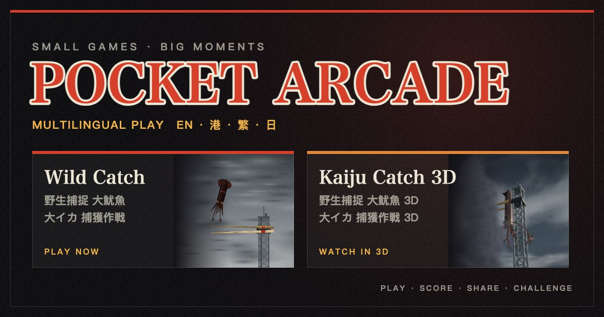
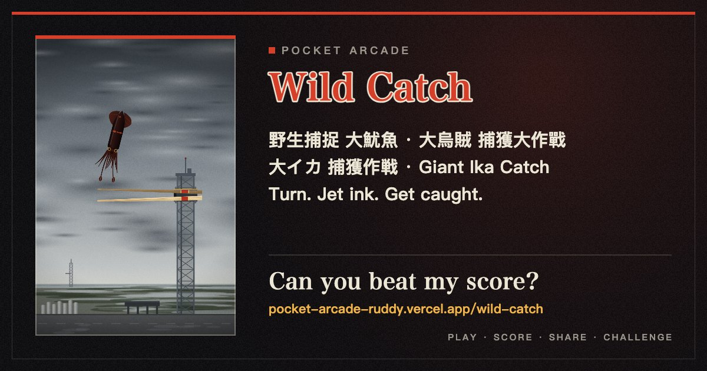
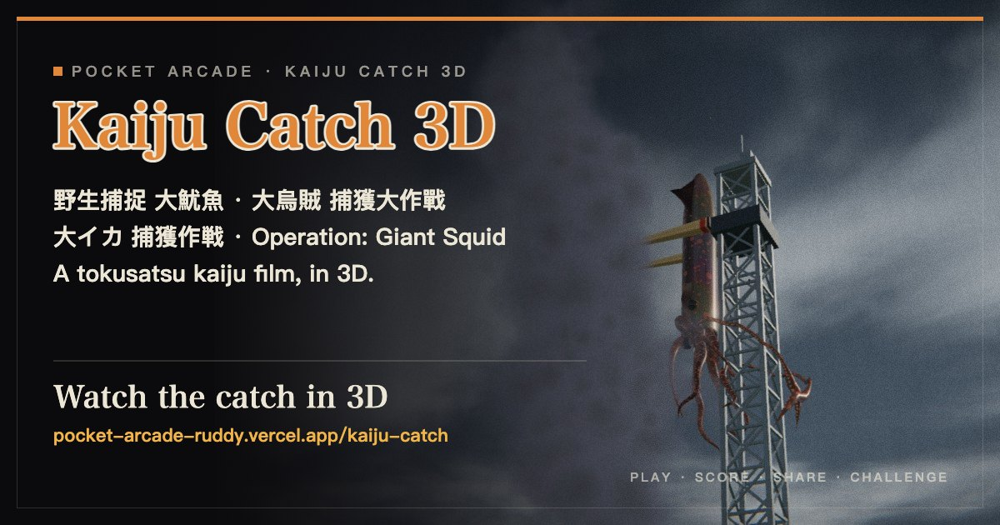
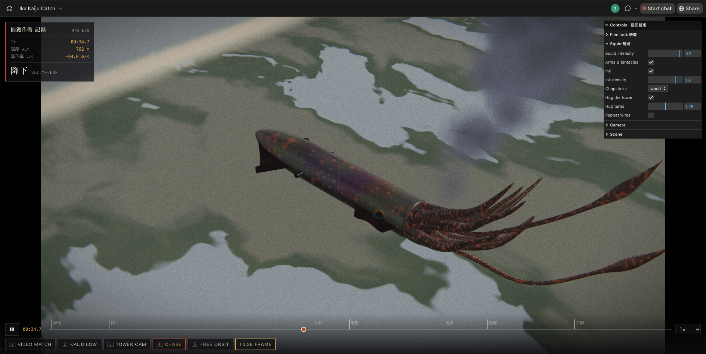
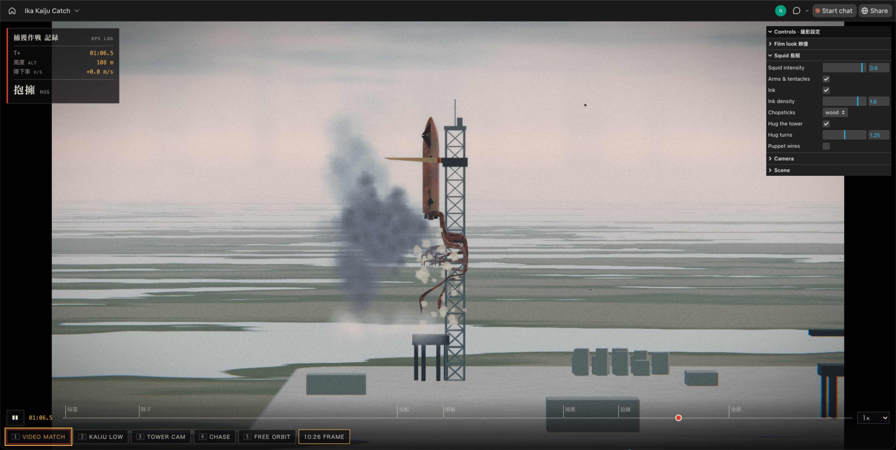

# Pocket Arcade



**Small games · big moments.** Tiny games you can finish in a minute. Every run ends with a score card you
can send to a friend as a challenge.

**Play:** <https://pocket-arcade-ruddy.vercel.app>

[](https://ko-fi.com/linanaotakashi)

Available in English, 港 (Hong Kong, Cantonese), 繁 (Taiwan) and 日 (Japanese).

## Games

### Wild Catch · 野生捕捉 大魷魚



*Turn. Jet ink. Get caught.* A giant squid falls back from space, belly first. Turn it, jet ink to brake,
and let the tower's chopsticks catch it. The tips only grip a squid that is
upright and slow.

- **Seven levels**, each with its own twist:

  | Level | Twist |
  | --- | --- |
  | 1 · Calm | Learn the controls |
  | 2 · Breeze | A side wind, and the press is waiting with cameras |
  | 3 · Wild wind | Wind that wanders in every direction |
  | 4 · Squalls | Gusts that snap between dead calm and +70% |
  | 5 · Clogged jet | One of three ink jets is blocked: less thrust, and the squid twists |
  | 6 · Fog and laser | Sudden fog; a blue laser from the tower head shows where it stands |
  | 7 · Dancing chopsticks | The chopsticks ride up and down the tower; match their speed |

- **Controls:** `←` `→` to turn, `↑` or `Space` to jet ink. On a phone: left
  thumb on ↺ ↻ (slide between them), right thumb on the jet button.
- **Score:** points for each catch and a bonus for a soft catch. Lose all three
  squids and you can continue on the same level (the score restarts) or start
  again from level 1.
- **Challenge:** you get a score card and a link that says how many levels you
  cleared and which ones are still to beat. A friend who opens it plays against
  your score.

### Kaiju Catch 3D · Operation: Giant Squid



The tower catch retold as a 1960s kaiju film, in 3D. Switch cameras, scrub the
timeline, slow it down, or freeze the 10:26 frame.

| The return: a belly-flop fall (chase camera) | The hug: arms coiled round the tower |
| --- | --- |
|  |  |

- **Cameras:** Video match, Kaiju low, Tower cam, Chase, Free orbit (keys `1` to `5`).
- **Deep links:** `?t=59&cam=KAIJU_LOW` opens at 59 s on the low kaiju camera.

## Sharing and challenges

1. Finish a game.
2. A 1200 × 630 score card is made on the spot.
3. Share it to WhatsApp or Threads, save the card, or copy a ready-made post.
4. Your friend opens the challenge link and plays against your score.

Pick a language with `?lang=en`, `?lang=zh-HK`, `?lang=zh-TW` or `?lang=ja-JP`.
The choice is remembered across all games.

## Run locally

No install and no build step. Serve the folder with any static server:

```sh
python3 -m http.server 4173 --bind 127.0.0.1
```

Then open <http://127.0.0.1:4173>. Analytics are skipped on localhost.

## Project layout

```text
index.html               hub page: game list, languages, how it works
wild-catch/index.html    2D canvas game
kaiju-catch/index.html   Three.js kaiju film
shared/arcade.js         shared engine: languages, score results, challenge links,
                         share cards, WhatsApp / Threads sharing
shared/analytics.mjs     Vercel Web Analytics loader
og/                      link-preview images (*.jpg) and README stills (*.png)
```

## Built with

- Plain HTML, CSS and JavaScript, no framework
- [Three.js](https://threejs.org) 0.160.0 and [lil-gui](https://lil-gui.georgealways.com) 0.19.2, loaded from jsDelivr
- Canvas 2D for the game and the score cards; Web Share API for sharing
- [Vercel](https://vercel.com) static hosting and Web Analytics

## Support the author ☕

Pocket Arcade is an indie project, free to play, with no ads and no sign-up. If a game made you smile, you can keep new games coming:

- **Buy me a coffee** on [Ko-fi](https://ko-fi.com/linanaotakashi)
- **Share a challenge link** with a friend
- **Star this repo** on GitHub

[](https://ko-fi.com/linanaotakashi)

## License

[MIT](LICENSE) © 2026 Gary Li
